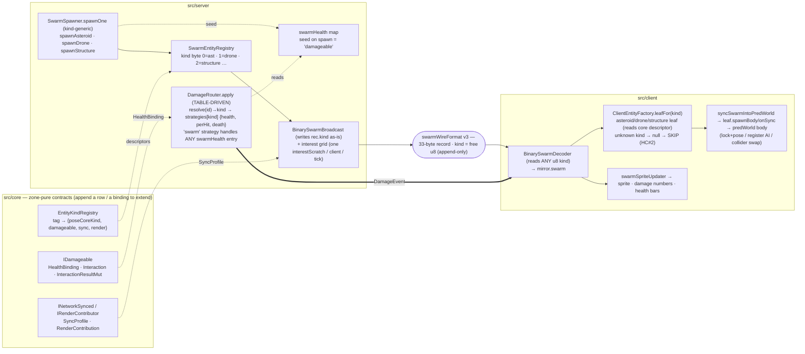

# Generic Entity Pipeline

> **Status: OOP migration COMPLETE on this branch** (`feat/generic-entity-pipeline`).
> The original build proved the thesis with a *data-driven* dispatch; it has been
> rebuilt as the planned **OOP entity model** — real leaf classes
> ([src/server/entity/leaves/](../../src/server/entity/leaves/)) that *compose*
> their damage/sync/render capabilities, a single monomorphic damage call site,
> and the B4 extraction layer (server `EntitySyncRouter` + client `EntityFactory`).
> **B1** (leaf classes), **B2** (`DamageRouter` → `EntityResolver` + monomorphic
> `applyInteraction`), **B3** (weapon flyweights — both fire resolvers' mode
> if-tree collapsed to one `weapon.resolveFire(ctx, sink)`), **B4** (client
> `EntityFactory` + per-kind leaves replacing the `swarmKindProfile` table
> [client]; the `EntitySyncRouter` routing/governance seam [server];
> `resolveEntityDisplayPose` rename), and **B5** (the kind=2 structure re-proven
> *through* the generic factory/router with **zero new dispatch sites** —
> `tests/e2e/structure-visible-damageable.spec.ts` + `structureEntity.test.ts`
> green) are **all landed and byte-identical** (golden-master + fire-parity +
> the integration suite identical to baseline + combat/structure E2E).
> **Outstanding pre-merge verdict:** `pnpm e2e:netgate` on a quiet host — the
> deterministic + byte-identity evidence is green, and the netgate is the standing
> live-loop verdict (deferred off the demonstrably-loaded dev box this session).
> Sections below tagged *(data-driven — superseded)* describe the build that was
> replaced.

## Why

EQX Peri grows *horizontally* — the roadmap keeps adding world-object types
(structures, capital ships, debris, black holes, mines, pickups). Before this
work, adding a type meant re-implementing the same four concerns from scratch in
several places, because dispatch was keyed on the **shape of a target's id
string**:

- `DamageRouter.apply` — an if-tree (originally `wreck-` prefix → lingering
  `!isActive` → active `playerId` → swarm registry; the wreck branch was
  later removed — wrecks retired P6.3/C3).
- `ProjectilePipeline` / `MissileSimulation` — the same fan-out re-implemented as
  collision passes.
- `ShieldHullRouter` — `damageShipLayered` (schema) vs `damageSwarmLayered` (maps).

The user's goal, in their words: *"when I add new structures/ships/debris/black
holes, I'm not starting from scratch… the bugs are the leaf's gameplay logic, not
'why can't I see it / why isn't it updating / why can't I damage it.'"* A new type
should be **a leaf + a small descriptor**, and networking / construction /
rendering / damage come for free.

## The three layers (genericity lives in registration + routing, NOT the wire)

1. **Pose-core wire stays homogeneous + UNCHANGED.** The 33-byte binary swarm
   record (`src/shared-types/swarmWireFormat.ts`, v3) carries the generic
   per-entity info every object has (x/y/vx/vy/angle/angvel + a `kind` byte). It
   is fast *because* it is branch-free and fixed-stride. A new pose-core-fitting
   type rides it via a **new `kind` byte value** (asteroid=0, drone=1,
   structure=2, …) with **no stride change and no `SWARM_WIRE_VERSION` bump** —
   the byte is a free `u8`. (Adding a new *continuous* field would force a
   deliberate v4 bump; a new kind value does not.)
2. **Capability extras ride OTHER channels** — the slim JSON snapshot slices or
   discrete event broadcasts.
3. **The generic part is registration + routing.** Each kind declares descriptors
   once; the dispatch/sync/render seams read the descriptor instead of branching
   on id-string shape.

## Zone split

`src/core/entity/` + the `IDamageable` / `INetworkSynced` / `IRenderContributor` contracts make a new world-object type "a leaf + a descriptor".

- **Core (zone-pure).** The append-only `EntityKindRegistry` ([src/core/entity/EntityKindRegistry.ts](../../src/core/entity/EntityKindRegistry.ts)) maps each `EntityKindTag` to its sync, render and damageable descriptors. `IDamageable` declares the damage surface: `HealthBinding`, a stateless per-kind accessor over the live store (never a value copy), plus the reused `Interaction` / `InteractionResultMut`. Core stays blind to the wire.
- **Server.** The kind-specific orchestration (broadcast, bus and worker side-effects) is a server concern. The leaf classes in `src/server/entity/leaves/` (`ShipEntity` / `DroneEntity` / `StructureEntity`) implement `Entity` and compose these contracts as data. `DamageRouter` routes a hit via `EntityResolver` to the leaf and one monomorphic `applyInteraction` (HC#5: never a per-class virtual `receiveInteraction`).
- **Two different types.** `Entity` is a separate type from `AiEntity` (`IAiBehaviour.ts`); don't conflate them.
- **Append-only.** Kinds and pose-core bytes are append-only (mirrors invariant #11).

## What each phase delivered

| Phase | Deliverable | Key files |
|---|---|---|
| **P1** | Zone-pure `Entity` base + capability contracts (`IDamageable`, `INetworkSynced`, `IRenderContributor`) + append-only `EntityKindRegistry`. Server `HealthBinding` singletons over the real stores. | `src/core/entity/`, `src/core/contracts/IDamageable.ts`, `src/server/entity/healthBindings.ts` |
| **P2 → B1/B2 (OOP)** | **B1**: real Entity leaf classes (`ShipEntity` / `DroneEntity` / `StructureEntity` damageable; `AsteroidEntity` non-damageable; `Projectile`/`MissileEntity` sync-only — B1 also built a `WreckEntity`, since retired P6.3/C3) that *compose* their `{ health, perHit, death }` + sync/render. **B2**: `DamageRouter.apply` → `EntityResolver.resolve(targetId) → leaf` + ONE monomorphic `applyInteraction` reading the leaf's composed data. Byte-identical, locked by the 12-case golden-master + leaf-parity test + `damageDispatch.bench.ts`. | `src/server/entity/leaves/`, `src/server/entity/EntityResolver.ts`, `src/server/rooms/DamageRouter.ts`, `DamageRouter.dispatch.test.ts` |
| **P3 → B4 (client)** | **B4**: client `EntityFactory` + per-kind client leaves (the OOP peer of the server leaves) — `leafFor(kind)` constructs the predWorld body, reading `staticBody = !descriptor.sync.interpolated` from the shared core `EntityKindRegistry` and holding only the client-specific bits (collider/mass/AI-ledger/shield-swap). Unknown kinds **skip** instead of being mis-routed as drones (HC#2). The old `swarmKindProfile` data table is DELETED; `ColyseusClient` remains the owner of the body/AI caches (the factory takes a reused zero-alloc ctx). | `src/client/net/entity/ClientEntityFactory.ts`, `src/client/net/entity/leaves/`, `tests/unit/clientEntityFactory.test.ts`, `ColyseusClient.syncSwarmIntoPredWorld` |
| **P4** | A static, damageable **STRUCTURE** (`SWARM_KIND_STRUCTURE = 2`) end-to-end as the proof. | `swarmWireFormat.ts`, `SwarmSpawner.spawnStructure`, the `structurePoses` trigger, the `STRUCTURE` profile case, `structureEntity.test.ts`, `structure-visible-damageable.spec.ts` |

## The "structure for free" proof — what it actually cost

Adding the structure touched only:

- **SEND**: one constant (`SWARM_KIND_STRUCTURE = 2`). It rides
  `BinarySwarmBroadcast` (writes `rec.kind` as-is) + the interest grid (a
  structure reuses the single `interestScratch` per (client,tick) — verified, no
  new `query9`) **unchanged**.
- **DAMAGE**: a `StructureEntity` leaf (`src/server/entity/leaves/`) + ONE arm in
  `EntityResolver` (`rec.kind === 2 → this.structure`) that selects it — then the
  SAME monomorphic `applyInteraction` a drone uses (set `target`, return leaf).
  The four dispatch SITES (`DamageRouter.apply` / `ProjectilePipeline` /
  `MissileSimulation` / `ShieldHullRouter`) gain **zero** branches — every one
  routes through the single resolver. Seeding `swarmHealth` on spawn is what makes
  it a damage target (absence = immune, like an asteroid). *(Pre-OOP this said
  "DAMAGE: nothing"; the honest post-B2 cost is "a leaf + one resolver arm",
  still far below the old 4-site if-tree.)*
- **CONSTRUCT / RENDER**: a `StructureClientLeaf` (static, no-AI, no-shield)
  selected by `ClientEntityFactory.leafFor(2)`. The factory then locks + poses it
  like an asteroid via the existing predWorld + sprite path.
- **SPAWN**: a `SwarmSpawner.spawnStructure` helper (`spawnOne` was already
  generic — its `kind===0/1` guards naturally exclude kind 2) + a `structurePoses`
  testMode trigger.
- **REGISTRY**: appended `'structure'` to the `EntityKindRegistry` (pose-core 2)
  and widened `SwarmKind` to `0|1|2`.

## Hardening (from the hostile review)

- **HC#1 — load-bearing dispatch order.** `DamageRouter`'s branch order +
  per-branch side-effects (broadcast / bus / worker `DESPAWN linger-<id>` /
  slot-freelist / `evictSwarmEntity` / the swarm-only `damage_applied` diag) are
  asymmetric and ordering-sensitive. The P2 collapse is locked by a golden-master
  written **before** the if-tree was deleted (test-first).
- **HC#2 — "a new kind byte needs no client changes" was HALF-FALSE.** The binary
  decoder reads any `u8`, but `syncSwarmIntoPredWorld` used `kind===0 ? asteroid :
  else-is-drone`, so a kind=2 would have been mis-registered as a
  `HostileDroneBehaviour`. The B4 client `EntityFactory.leafFor(kind)` makes
  routing explicit: an unknown kind returns `null` → skip; a wired kind routes to
  its leaf.
- **HC#3 — drone HP lives in a parallel map** (`CombatSubsystem.swarmHealth`), so
  `HealthBinding` holds a *reference* to the live store, never a value copy.
- **HC#5 — monomorphic dispatch (the OOP synthesis).** The leaves are real objects
  (identity / sync / render), but the damage call site stays MONOMORPHIC: ONE
  `DamageRouter.applyInteraction` reading the leaf's composed `health` / `perHit` /
  `death` DATA — never a per-class virtual `leaf.receiveInteraction()` across the N
  leaf classes (that megamorphic-deopts under ramming/projectile load). OOP for
  identity/sync/render where polymorphism is cheap; one hot function for damage.
  Lock: the `DO NOT replace this with receiveInteraction` guard comment in
  `DamageRouter` + `benchmarks/damageDispatch.bench.ts` (mixed-kind ≈ single-kind
  per `apply` — no cliff).

## Deliberately NOT done

- **No rewrite of the broadcasters' byte-level encoding.** B4 added an
  `EntitySyncRouter` ([src/server/rooms/EntitySyncRouter.ts](../../src/server/rooms/EntitySyncRouter.ts))
  as the single per-tick orchestration seam — it owns the routing DECISION +
  ordering (pose-core binary FIRST so the interest scratch is built before the
  json-slice send reuses it — HC#4) + a boot-time `SyncProfile.transport`
  governance check (which finally makes `transport` load-bearing). But the proven
  `SwarmBroadcaster` / `SnapshotBroadcaster` keep their byte-level encoding
  UNCHANGED. Making the router own per-entity *iteration* would move wire bytes
  (the fixed-stride binary record + the tuned 20 Hz json-slice loop) for zero
  functional gain — so it does not; the netgate is the verdict if that is ever
  attempted.
- **No projectile/missile collision moved into the physics worker.** The
  main-thread lag-comp split is strategic; only the *dispatch tail* collapsed.

## Verification

- Deterministic: `pnpm typecheck && pnpm lint && pnpm test` (1781 unit) + full
  integration suite green (incl. `structureEntity.test.ts`).
- Functional E2E: `structure-visible-damageable.spec.ts` (chromium) — the
  structure renders + is shootable.
- Performance: `pnpm e2e:netgate` PASS — net-feel comparable to `origin/main`
  (rollingCorrRate identical, ticksAhead better, drift/drop within the
  noise-tolerant AND-gate margins).
- On-device: the game boots + plays on a real Android phone, and the kind=2
  structure renders there (`tests/mobile-perf/phone-structure.spec.ts`).

## Adding the next pose-core type (the recipe this bought you)

1. Append `SWARM_KIND_<X> = N` to `swarmWireFormat.ts` (no stride/version bump).
2. Append the kind to `EntityKindRegistry` (core) + a client leaf in
   `src/client/net/entity/leaves/` wired into `ClientEntityFactory.leafFor`
   (static-vs-dynamic is derived from the descriptor; the leaf holds the
   collider/mass/AI/shield specifics).
3. A `SwarmSpawner.spawn<X>` entry point + a spawn trigger. If it should be
   damageable: seed `swarmHealth` on spawn, add a server `<X>Entity` leaf
   (`src/server/entity/leaves/`), and one selection arm in `EntityResolver`
   (`rec.kind === N → this.<x>`) — then it rides the same monomorphic
   `applyInteraction` (no new dispatch SITE). Non-damageable kinds need none of
   this (the resolver returns `null`, like an asteroid).
4. (If it needs a distinct collider/sprite) its vertices/mass at the kind-explicit
   construction site + a sprite arm. A circle + the asteroid sprite is the
   zero-effort default.
5. Add the "new visible entity ⇒ full-snapshot-path integration test" (server
   CLAUDE.md mandate) + an E2E if it's player-facing.

The four combat/sync dispatch sites do **not** change.

## Architecture diagram

**The five touch-points for a new pose-core kind** (everything else is reused): a
registry row (core), a client leaf wired into `ClientEntityFactory` (client), a
`spawn<X>` entry point + spawn trigger (server), `swarmHealth` seeding if
damageable (server), and — only if it needs a distinct look — its vertices/mass +
a sprite arm.

## Worked examples

### A new "mine" weapon

A mine is a *deployed, static, damageable hazard that detonates on proximity*. It
splits cleanly into the **entity** (free) and the **weapon behaviour** (the only
real new code — exactly "the leaf's gameplay logic"):

**Free (rides the pipeline, like a structure):** a `'mine'` pose-core kind
(`SWARM_KIND_MINE = 3`); `SwarmSpawner.spawnMine` (mirrors `spawnStructure`); a
`MineClientLeaf` wired into `ClientEntityFactory` (static, no-AI, no-shield); a
sprite arm; an `EntityKindRegistry` row. Seed `swarmHealth` → it is shootable through the
unchanged `DamageRouter` 'swarm' strategy. Carry an `ownerId` so it ignores its
deployer.

**New code (the mine's behaviour):**
1. **Deploy** — a `WeaponCatalogue` entry with a `'deploy'` mode (append-only,
   invariant #11). `PlayerFireResolver` on a deploy-mode fire `spawnMine(...)` at
   the player's pose instead of a projectile/beam. (Extends the weapon-mode union
   + one fire-resolver branch.)
2. **Proximity trigger** — a per-tick check (the mine's tick): is a non-owner
   within `triggerRadius`? This wants the **`entities-within-radius` query** noted
   as future Phase 5 (layers on the existing interest grid; allocation-free).
3. **Detonate → splash** — on trigger, find entities within `blastRadius` (same
   radius query) and `applyDamage` each. The damage **dispatch is free** —
   `applyDamage` already routes through `DamageRouter` to whatever's hit (ships,
   drones, structures, other mines). Reuses `MissileSimulation`'s splash shape.
   Then evict the mine (like any swarm entity).

Net: you write the *trigger + detonation* logic and a catalogue row. You never
write "why can't I see the mine / network it / shoot it" — those are free. (The
mine also motivates building the Phase-5 radius query, which then serves
black-holes / area-forces too.)

### A new SET of structures (walls, turrets, reactors, …)

Two scaling strategies depending on whether they differ *cosmetically* or
*behaviourally*:

**Cosmetic / static variety → one kind + a structure catalogue (NO new kind
bytes).** Keep all of them on `SWARM_KIND_STRUCTURE = 2` and carry a **subtype**
in the spare `shipKind` byte (offset +32 — "meaningful only when kind=drone"
today; repurpose it as the structure-subtype index when kind=2; still no
stride/version bump). Add a `StructureCatalogue` (the same append-only-catalogue
pattern as `SHIP_KINDS` / `WeaponCatalogue`): `subtype → {shape/vertices, health,
mass, sprite}`. Adding a structure = **one catalogue row**. The spawner reads
health/shape/mass per subtype; the client decoder reads the subtype byte → the
right sprite + collider; the damage path is unchanged. A set of N static
structures = N catalogue rows + N sprites — zero new kind bytes, zero new
dispatch, zero new network code. (This is exactly how `SHIP_KINDS` gives many
ship variants inside the `drone` / `active-ship` kinds.)

**Behavioural variety → leaf logic (+ a kind only if client routing differs).** A
turret that shoots back, a reactor that chain-explodes, a generator that buffs
allies — that *behaviour* is a per-tick server hook (like the mine's proximity),
small and self-contained. Give it its own kind byte only if its **client routing**
genuinely differs (e.g. a turret needs AI/mount rendering → a profile with
`hasAiBehaviour`); otherwise keep it on kind 2 + subtype + a server-side
behaviour hook. The entity infrastructure (spawn / render / network / take-damage)
is free either way.

**Rule of thumb:** *cosmetic/static variety lives in a catalogue (data);
behavioural variety lives in a leaf hook (small code); a new client routing shape
earns a new kind byte.*

## Client rules in detail

Moved verbatim from `src/client/CLAUDE.md`, which keeps the short form of each rule and points here.

- **Binary-swarm (pose-core) entities construct through the client `EntityFactory` (Generic Entity Pipeline B4, 2026-06-04).** `ColyseusClient.syncSwarmIntoPredWorld` no longer branches `kind===0 ? asteroid : else-is-drone` (that mis-registered any future kind as a `HostileDroneBehaviour` — HC#2), nor reads the old `swarmKindProfile` data table (DELETED). It calls [`net/entity/ClientEntityFactory.ts`](../../src/client/net/entity/ClientEntityFactory.ts) `leafFor(kind)` → a per-kind client leaf ([`net/entity/leaves/`](../../src/client/net/entity/leaves/): asteroid/drone/structure), the **OOP peer of the server leaves** in `src/server/entity/leaves/`. An **unrecognised kind returns `null` and is SKIPPED** (never the drone path — HC#2). Each leaf reads the SIDE-NEUTRAL facts from the shared core `EntityKindRegistry` (`staticBody = !descriptor.sync.interpolated`) and holds only the client-specific construction (collider shape, catalogue mass, AI-ledger registration, shield-collider swap). Adding a pose-core kind = a registry row + a leaf + a factory `case` (+ a sprite arm). A static structure (kind 2) is asteroid-like client-side but damageable server-side. The wire (`swarmWireFormat.ts`) gains only a new `kind` byte value — no stride/`SWARM_WIRE_VERSION` bump.
  - **Cache ownership stays in `ColyseusClient`, NOT the factory (load-bearing).** `predSwarmKeys` / `_movingSwarmKeys` / `_swarmBodyKeyCache` / `_aiRegisteredIds` are read across `syncSwarmIntoPredWorld` (spawn + teardown sweep), the per-snapshot remote-entity anchor (`anchorRemoteSwarmBodies` reads `_swarmBodyKeyCache`), the local beam ray (`DisplayPoseHitscan` reads `_movingSwarmKeys` + `_swarmBodyKeyCache`), and `resetPredictionState`/`dispose` (clear-by-name on sector handoff). The factory takes a REUSED `_clientSpawnCtx` (one class-field instance mutated per entity — zero per-entity alloc, invariant #14); a leaf that registers AI sets `ctx.registeredAiId` and the client folds it into `_aiRegisteredIds`. **Do NOT move these caches into the factory** — the anchor and the beam ray read them directly, and the sector-handoff teardown contract clears them by name. Teardown of the AI-ledger entry stays caller-owned via `_aiRegisteredIds` (the kind is unavailable at sweep time; that set is the precise drone marker). Full story: [docs/architecture/generic-entity-pipeline.md](../../docs/architecture/generic-entity-pipeline.md).

### Phase A3 — Renderer decision logic extraction (2026-05-13)

Per-entity sprite-update decisions (create / rebuild / reposition / skip) live in `src/client/render/spriteUpdateDecisions.ts` as pure functions, NOT inlined inside `PixiRenderer.ts`. The Pixi calls (Graphics instantiation, `addChild`, `tint`, `alpha`, `destroy`) stay in the renderer; only the branching lives in the pure module.

**Why**: the Phase 6b "lingering hull permanently invisible" bug was a too-aggressive `if (!ship.kind) continue;` skip in the renderer that left the sprite uncreated forever when the schema diff with `kind` arrived late. A unit test on a pure decision helper would have failed loudly: "no cache + unknown kind should `create` with the fallback kind, not `skip`." The extraction makes that contract explicit and testable.

**The rule**: when you add a new entity-update method on the renderer (`updateXxx` taking `RenderMirror`), the per-entity decision logic MUST live in `spriteUpdateDecisions.ts` with unit tests covering every branch + a property-based test (fast-check, already installed). Don't inline new decision branches in `PixiRenderer.ts`.

Current functions:
- `decideLingeringSpriteAction({ cached, currentKind, fallbackKind })` — Phase 6b lingering hulls. Falls back to `fallbackKind` when `currentKind` is undefined and there's no cache hit (don't lock in the wrong silhouette but also don't go invisible).

Tests: `src/client/render/spriteUpdateDecisions.test.ts` (12 cases incl. fast-check properties).

## Server implementation notes

> Moved from `src/server/CLAUDE.md`. The short rules stay there; this is the detail.

### Generic Entity Pipeline — OOP damage dispatch + a new pose-core kind (2026-06-04)

`DamageRouter.apply` routes through real Entity LEAVES: `EntityResolver.resolve(targetId)`
returns the live leaf it names (`ShipEntity` / `DroneEntity` /
`StructureEntity` in [src/server/entity/leaves/](../../src/server/entity/leaves/)), then ONE
monomorphic `DamageRouter.applyInteraction(leaf, …)` reads the leaf's COMPOSED
`{ health, perHit, death }` data (`applyLayered → broadcast → perHit → death`).
Each leaf owns its identity + pose and composes its damage strategy + sync/render
descriptors — a new damageable type is **a leaf + a registry row**, ZERO new
dispatch branch here. Byte-identical to the former if-tree / strategy-table
(locked by `DamageRouter.dispatch.test.ts`, the golden-master — HC#1: branch
order + per-branch side-effects are load-bearing). The ordered shape-based
selection (lingering→active→swarm; an asteroid, kind 0, is **non-damageable**
→ the resolver returns `null` = immune; wrecks RETIRED in P6.3/C3) lives in
[EntityResolver.ts](../../src/server/entity/EntityResolver.ts).

**HC#5 (monomorphism guard).** `applyInteraction` is ONE concrete function
reading the leaf's composed DATA — it must NEVER become a per-class virtual
`leaf.receiveInteraction()` across the N leaf classes (that megamorphic-deopts in
V8 under ramming/projectile load). The leaves are objects for identity/sync/render
(where polymorphism is cheap + clarifying); the per-hit hot work stays one
monomorphic call site. Lock: the `DO NOT replace this with receiveInteraction`
guard comment + `benchmarks/damageDispatch.bench.ts` (mixed-kind ≈ single-kind
per `apply` — no cliff). Adding a damageable type does **not** add a branch here.

A new **pose-core** entity type (e.g. `SWARM_KIND_STRUCTURE = 2`) is a
swarm-registry record — it rides `BinarySwarmBroadcast` (writes `rec.kind`
as-is, no encoder change), the interest grid (reuses the single per-(client,tick)
`interestScratch`, no new `query9`), and the `DamageRouter` 'swarm' strategy for
free. The only damage-specific line is seeding `swarmHealth` on spawn (absence =
immune, like asteroids). `SwarmSpawner.spawnStructure` mirrors `spawnAsteroid`
(`spawnOne` is already kind-generic). Test trigger: the testMode `structurePoses`
room option (mirrors `dronePoses`) → `structure-test` E2E room. New visible type
⇒ the integration-test mandate above applies (`structureEntity.test.ts`). Full
story: [docs/architecture/generic-entity-pipeline.md](../../docs/architecture/generic-entity-pipeline.md).

**EntitySyncRouter (GEP B4) — the per-tick send orchestration seam.** Both
entity-sync sends in `SectorRoom.update()` now route through ONE
[EntitySyncRouter](../../src/server/rooms/EntitySyncRouter.ts) `route(phaseTime)` call instead of
calling the two broadcasters directly. The router owns the **ordering decision**
— pose-core binary FIRST (`SwarmBroadcaster.broadcast()` builds the
per-(client,tick) `interestScratch`), then json-slice
(`SnapshotBroadcaster.broadcast(sectorIdle)` reuses it, no second `query9` —
**HC#4, now enforced by the router, not the caller**) — and evaluates sector-idle
**between** the two sends (verbatim: `swarm.broadcast` may apply backpressure
before idle reads `clients.length`, so the order is preserved, not reordered).
The proven broadcasters keep their **byte-level encoding UNCHANGED** (the safe
shape — making the router own per-entity iteration would move wire bytes for zero
gain; STOP+flag + netgate if ever attempted). Its constructor runs a **boot-time
`SyncProfile.transport` governance check** (`assertTransportGovernance`) that
validates every `EntityKindRegistry` kind's transport is well-formed and that the
pose-core bytes match the wire constants — this is what finally makes
`SyncProfile.transport` load-bearing (boot-time only, never in the `route()` hot
path). Hot path is allocation-free (#14): the idle closure is built once at
construction, `phaseTime` is passed by reference. Lock: `EntitySyncRouter.test.ts`
(ordering + idle-threading + governance); the full-snapshot-path byte-identity is
the netgate + the existing integration suite.

## History

> Updated 2026-06-04 (GEP B2): the data-driven `strategies[kind]` table is now
> the **OOP entity pipeline**. The damage SHAPE is real leaf objects, not a
> side table.
